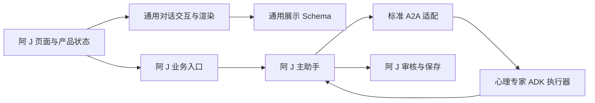

# ADR-0010：先在阿 J 提取通用对话交互，并引入标准 A2A

状态：本地实现与验证完成，2026-11-13；未部署、未进行真实模型或手机验收。

## 背景与范围

阿 J 已有较完整的对话、作品、表单与失败恢复验证。负责人决定将本次架构调整从卜卜分支独立出来，先在阿 J 完成，再由卜卜按需接入；本轮不修改卜卜应用。通用能力覆盖单选、多选、表单、卡片、代码块和数据表格，Chart 暂不纳入。历史图片、网页与练习表单仍须兼容。

最终方向是双向专家协作：阿 J 可咨询科学育儿 Agent，卜卜可咨询阿 J 的心理专家。接入专家不意味着切换产品身份、复制全部聊天或赋予对方写入业务记录的权限。

## 职责划分

| 位置 | 拥有的职责 | 宿主必须提供的内容 |
| --- | --- | --- |
| `base-chat-protocol` | 版本化展示文档、受限作品与答案、A2UI 编译与校验、AG-UI 事件读取 | 目录、资源定位、业务标识适配 |
| `chat-ui-taro` | 组件渲染、表单草稿与提交状态、输入栏、语音会话和发送恢复 | 主题文案、资源读取、平台驱动、发送与状态查询 |
| `agent-a2a` | 标准 A2A 1.0 的 Agent Card、官方客户端与服务端适配、任务与请求身份处理 | 已认证身份、任务存储、请求账本、专家执行器、可信端点配置 |
| `a-j-oker-contracts` | 阿 J 输入输出、心理视角、数值轮次、目录和旧协议适配 | 不适用 |
| 阿 J 应用 | 年龄与隐私门禁、权限、审核、预算、知识与模型、主助手编排、最终记录保存 | 不适用 |

依赖从应用指向通用模块。通用模块不导入阿 J 或卜卜业务类型、Payload、年龄规则、产品环境常量和模型配置。Taro 渲染与无界面的提交状态逻辑分别导出，后端不能因使用协议类型而引入浏览器运行时。

## 六类展示能力

单选与多选使用稳定选项 ID，标签只用于展示。表单使用结构化答案；补充文字、未填写、数值零不能混为一谈。服务端根据已保存的题目再次验证选项、字段和约束，客户端校验只改善交互。

卡片承载受限内容，代码块只展示与复制，不执行代码；数据表格保留字符串、数值、布尔值与空值的差别。通用渲染能力不扩大阿 J 的产品服务范围，支持代码块不等于开放编程助手。

展示身份、修订号与提交请求身份有不同生命周期。答案必须指向正确的展示、表单与修订；一次提交在结果未确认时保持同一请求身份。生成这份表单的请求身份不能充当后续用户答案的请求身份。

新目录必须显式版本化。历史数据走受限兼容读取，不能通过静默改变旧目录含义获得兼容；不执行破坏性历史迁移。未知目录或不可用作品退化为可阅读的文字回应。

## 对话交互复用

共享模块处理发送期间防重、失败后的状态查询、明确失败与结果未知的区别，以及确认保存后的恢复。宿主决定会话选择、身份失效、授权、业务 API 和草稿保留策略。阿 J 继续只在当前页面内存保留未发送草稿。

表单关闭后保留未提交答案；只有服务端确认成功才视为完成。刷新历史失败不能把已经保存的回复改成发送失败。身份或会话作用域变化后，旧异步结果不能写入新作用域。

## 标准 A2A 与现有运行时

采用官方 `@a2a-js/sdk` 1.3.0 的 A2A 1.0 JSON-RPC 实现。A2UI 描述展示，AG-UI 传递对话界面事件，A2A 表达 Agent 任务协作；三者不互相替代。ADK 继续执行已有专家，不另建模型或工具引擎。

第一阶段在阿 J 的已授权执行链内，通过官方客户端和服务端适配传递标准请求与结构化心理方案。每个启用的专家有独立逻辑标识与 Agent Card，不要求为每个专家部署独立进程。宿主内传输与未来跨服务传输使用相同协议接口。

当前平台服务限定不因本次重构自动解除：不开放任意外部地址、BYOK 或旧外部 bearer 凭证，也不新增面向公网的专家入口。内部传输的身份由已授权的宿主请求绑定，不能采信模型消息中的 owner、角色或授权声明。后续跨产品接入需要独立完成服务身份、用户委托、数据最小化和撤销验证。

专家方案仍由主助手整合。专家不能写用户最终聊天、照护记录或执行其他业务变更；心理危机分流、专家数量与调用预算、知识引用校验和最终审核保持有效。专家失败不能被描述成已完成咨询。

任务状态与请求账本由宿主持久化，并按用户、租户和专家隔离。重复请求不得重复执行；同一请求身份携带不同内容必须拒绝。完成结果可恢复；进程退出不代表未完成执行可以无条件重跑。取消也不代表既有业务副作用已经撤销。

## 与既有决策的关系

保留 ADR-0001 的 Payload 数据所有权及 ADK 执行职责，保留 ADR-0004 的主助手控制与专家隔离、ADR-0005 的配置和知识权限。扩展 ADR-0003 的作品类型，并修订 ADR-0006 中“不改变模型产物格式”的范围：这次显式引入版本化展示与新选择字段，必须通过旧记录兼容验证；继续使用官方 A2UI 核心，不维护另一套数据更新器。

## 验收要求

- 阿 J 实际使用共享 Schema、交互和渲染，不能只留下无人调用的新包；卜卜目录无改动。
- 六类能力以及旧作品通过校验与渲染测试；覆盖伪造选项、过期修订、重复提交、草稿保留和历史读取。
- 官方 A2A 客户端经过真实本地 HTTP 验证发现、发送、查询、流式状态、补充输入与取消，并验证跨身份拒绝、请求重放与存储重建后的恢复。
- 阿 J 原有专家编排、权限、预算和历史恢复回归通过；持久化数据纳入删除、留存与恢复流程。
- 类型、静态检查、单元与集成测试、H5 和微信构建通过。部署、真实模型输出与手机验收另行记录。

## 本次实现与验证记录

工作独立于卜卜分支，基于主线 `1a1a0efc11af2feb3f1f46f75e83e22af4178640`。阿 J 实际调用两个新增包 `chat-ui-taro` 与 `agent-a2a`；通用展示结构留在 `base-chat-protocol`，阿 J 目录及旧协议适配移至 `a-j-oker-contracts`。卜卜应用和既有依赖解析没有改动。

心理专家当前采用官方 SDK 客户端 → 进程内 Request/Response 传输 → 官方 SDK 服务端 → 原有 ADK 执行器的链路。阿 J 的 Payload 集合持久化任务和请求账本；显式迁移、归属隔离、并发保留、终态约束、删除重试及留存/恢复已用隔离 SQLite 验证。跨产品服务身份、用户委托和公网入口仍属于后续接入阶段。

独立复核结果：

| 范围 | 通过的测试 |
| --- | ---: |
| 通用展示协议 | 15 |
| 阿 J 业务契约 | 14 |
| 通用对话 UI | 19 |
| 标准 A2A 基础包 | 10，含真实本地 HTTP，无跳过 |
| 阿 J 服务端 | 476 |
| 阿 J 小程序/H5 源码 | 228 |

上述模块的类型与静态检查通过。另通过微信构建及原生 WXSS 检查、H5 构建、含 H5 静态文件同步的 Next 生产构建；构建使用隔离测试配置。数据库脚本覆盖旧作品与选择答案、专家配置、隐私、交互及迁移；涉及模型执行的脚本使用合成模型，不构成真实模型质量验收。构建上下文检查及 48 项部署工具夹具测试通过，未执行部署。

前端回归覆盖原展示引用与修订号往返、微信禁用动态函数、明确失败与结果未知的请求身份处理、不可提交表单不误报成功，以及身份清除/卸载后旧会话创建结果不继续发送。Taro 构建的共享源码路径适配留在阿 J 宿主配置，通用组件包不承担平台编译插件依赖。

### 2026-11-13 bounded repair record

修复提交恢复控制器的泛型操作标识、账本恢复缺少行保护，以及 A2A 恢复查询的取消、截止时间与失败关闭行为。补充旧发送未决时的新作用域锁、缺席/未完成恢复、恢复中取消和查询失败不发送的回归。本轮只做代码审查修复；通过的相关类型检查、目标测试和局部 ESLint 不替代前述完整验收记录。
