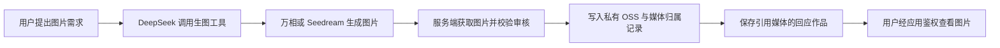

# a-j-oker 图片生成能力调研

调研日期：2026-10-14（Asia/Shanghai）。本文区分公开 API 事实、仓库现状与接入建议；未调用付费图片生成接口，也未实测画质、延迟或账号权限。厂商网页及搜索索引会更新，下面的版本与价格是本次可核实的公开资料，不代表所有账号都已开放，也不构成市场份额排名。

## 结论

- DeepSeek 可以继续承担对话、构思提示词和调用工具；真正的图片生成交给独立的图片模型。其公开模型列表目前将输出模态列为 `text`，本次没有找到可直接输出图片的官方商用 API。不能据此说 DeepSeek 的所有模型都不会生图：Janus 系列是另一条开源多模态路线。
- 国内优先评估阿里云百炼的万相与火山方舟的 Seedream；腾讯混元作为备选。它们都是有官方接入文档的候选，不表示“国内多数应用一定用哪家”。
- 服务商返回的图片链接是交付中间结果。生成成功后应下载、校验、保存到项目自己的私有 OSS，再通过已有归属与鉴权规则向用户展示回应作品。已经使用 OSS 不意味着必须选择阿里的图片模型，也不意味着服务商自动把图片存进本项目的桶。

## DeepSeek 的能力边界（已核实）

DeepSeek 官方 `/models` 文档把 `output_modalities` 的可选值限定为 `text`，示例中的 `deepseek-flash` 与 `deepseek-v4-pro` 都只列出文本输出。因此，现阶段不应把聊天 API 当成图片生成 API。[官方模型列表](https://api-docs.deepseek.com/api/list-models/)

同时，`deepseek-flash` 已支持图片输入和图像理解，“能看图”与“能生成图片文件”应分别判断；不能再笼统写成 DeepSeek 不支持图片。[官方图像理解文档](https://api-docs.deepseek.com/zh-cn/guides/vision/)

DeepSeek 官方 Janus 仓库明确包含 Janus、JanusFlow、Janus-Pro 的多模态理解与视觉生成能力，并提供模型下载、推理代码及演示。它不是把当前聊天 API 的模型名换一下就能调用的托管生图服务；采用它意味着另行部署或选择托管供应方，并评估部署与模型许可。[官方 Janus 仓库](https://github.com/deepseek-ai/Janus)

DeepSeek 的工具调用可以承接“需要图片时请求生图工具”的职责，具体图片 API 由服务端执行。这是接入建议，不意味着当前 a-j-oker 已配置这项工具。[官方 Tool Calls 文档](https://api-docs.deepseek.com/zh-cn/guides/tool_calls/)

## 国内 API 候选（已核实）

| 候选 | 已核实的版本与能力 | 调用及交付方式 | 接入注意点 |
| --- | --- | --- | --- |
| 阿里云百炼·万相 | `wan2.6-t2i` 负责文生图；`wan2.6-image` 支持参考图编辑、风格迁移与图文混排 | 2.6 提供 HTTP 同步和异步接口；异步返回任务 ID 后查询结果。结果为 PNG 图片 URL，24 小时有效 | 使用百炼 API Key；地域与请求域名必须匹配。新版文档采用带 Workspace ID 的业务空间域名。不能把 OSS 的访问凭证当作百炼 API Key |
| 火山方舟·Seedream | 本次重点核实 5.0 pro / flash：文生图、单图/多图参考生成、交互编辑 | `/api/v3/images/generations` 的标准调用直接返回结果；5.0 pro / flash 不支持流式输出。可选 URL（24 小时有效）或 `b64_json` | 方舟 API Key，开通对应模型后使用 Model ID 或 Endpoint ID；本文核实的是北京接入域名。可输出 JPEG 或 PNG |
| 腾讯云·混元 | 已核实旧平台极速版文生图；API 概览另列 3.0 异步生图、图生图和编辑能力 | 极速版直接返回 Base64 或 URL，URL 为 1 小时；3.0 为提交/查询任务接口，不应混用不同版本的结果规则 | 官方已提示服务逐步迁至 TokenHub；新接入应先核对 TokenHub 当前支持的模型与权限，旧 API 文档不等于新账号可以直接开通 |

表格来源：

- 百炼：[文生图 V2 API](https://help.aliyun.com/zh/model-studio/text-to-image-v2-api-reference)、[图像生成与编辑 2.6 API](https://help.aliyun.com/zh/model-studio/wan-image-generation-api-reference)。2.5 及更早文生图版本仅提供 HTTP 异步接口，不应把这个限制套用到 2.6；输入支持 Base64 也不表示结果可选 Base64。
- 方舟：[图片生成 API](https://docs.volcengine.com/docs/ark/image-generation-api?lang=zh&redirect=1)、[快速开始](https://docs.volcengine.com/docs/ark/quick-start?lang=en)、[模型列表](https://docs.volcengine.com/docs/ark/model-list?lang=zh&redirect=1)。公开列表已列出 `doubao-seedream-5-0-flash-260915`；旧的 5.0 lite、4.5 页面被标注为即将下线，因此不建议仅照搬旧教程锁定旧版本。
- 混元：[极速版 API](https://cloud.tencent.com/document/api/1668/120721)、[API 概览](https://cloud.tencent.com/document/product/1668/88077)、[迁移提示](https://cloud.tencent.com/document/product/1668/90897)。

这不是完整模型目录。百炼文生图总览还列出万相 2.7 和千问生图系列，后续实测可把它们加入同一组提示词比较；本文使用 2.6 作为有明确接口与价格证据的接入基线，不声称它是最新或最优版本。[百炼文生图总览](https://help.aliyun.com/zh/model-studio/text-to-image)

### 价格参考

以下为 2026-10-14 查阅的人民币公开标价，不包含 OSS 存储、访问流量、DeepSeek 对话、重试或优惠；实际开通前应复核模型、地域与账号报价。

| 服务与范围 | 模型 | 公开图片价格 |
| --- | --- | --- |
| 百炼·华北 2（北京） | `wan2.6-t2i`、`wan2.6-image` | 均为 0.20 元/张 |
| 火山方舟国内站，北京 API 接入候选；计费页未单列地域价差 | Seedream 5.0 flash | 输出 0.12 元/张，输入图免费 |
| 同上 | Seedream 5.0 pro，单图生成 | 输出不超过 261 万像素 0.30 元/张，超过该值 0.60 元/张；参考图首张免费，第 2 张起 0.02 元/张 |

价格来源：[万相 2.6 文生图模型页](https://help.aliyun.com/zh/model-studio/wan2-6-t2i)、[万相 2.6 图像模型页](https://help.aliyun.com/zh/model-studio/wan2-6-image)、[火山方舟模型价格](https://docs.volcengine.com/docs/ark/model-pricing?lang=en&redirect=1)。不要套用同厂商其他平台（如扣子、LAS 或视觉创作平台）的报价。

## 仓库现状

以下结论来自当前工作区源码，未检查线上环境变量，也未进行 OSS 连通性测试。

| 环节 | 当前实现 | 对接生图的含义 |
| --- | --- | --- |
| 对话模型 | 默认 `deepseek-flash`，调用官方 `/chat/completions`；返回契约接收文字与工具调用 | 保留现有对话模型，新增独立生图服务即可。见 [模型适配](../src/models/deepseek.ts) |
| Agent 工具 | 只有 `save_greeting`，工具名称白名单也只允许它；一轮最多 3 次模型调用，总执行时限 60 秒 | 仅改提示词不能获得生图能力，需要新增工具并调整工具选择及执行时限。见 [执行流程](../src/agent/runtime.ts) |
| 图片回应作品 | `source.type=illustration` 保存几何形状描述；`source.type=media` 引用已有媒体编号 | 当前没有专用生图模型。新增图片保存为媒体后可沿用作品协议。见 [作品契约](../../../packages/base-chat-protocol/src/artifacts.ts)、[模型指令](../src/agent/instruction.ts) |
| 几何图文件 | 读取作品时，程序将形状描述绘制为带 AI 标识的 PNG；保存回应时也会绘制副本做审核 | 这类图片目前没有调用 `MediaService.save`，不会因为已配置 OSS 就自动入桶。见 [图片绘制](../src/domain/artifact-rendering.ts)、[回应保存](../src/domain/greetings.ts) |
| 私有图片存储 | `HELLO_MEDIA_STORAGE=oss` 时，`MediaService.save` 写私有 OSS，Payload 保存所属用户、对象引用、大小、摘要；默认配置仍可使用数据库 | 新生图工具必须显式调用媒体保存链路。不能只把供应商 URL 填进回复。见 [媒体服务](../src/domain/media.ts)、[OSS 适配](../src/storage/oss.ts) |
| 图片展示 | `/api/hello/artifact-image/{turnId}/{artifactId}` 读取作品后，按来源绘制或读取媒体；媒体读取校验所属用户及隔离状态。H5 使用现有登录身份，小程序带凭证下载后预览 | 前端已具备显示图片回应作品的基础，无需让模型编造链接。见 [服务端路由](../src/app/api/hello/[...path]/route.ts)、[小程序图片读取](../../a-j-oker-miniapp/src/chat/api.ts) |

当前媒体写入固定使用 JPEG、`.jpg` 对象名与 `image/jpeg`，保存上限为 **2 MiB**；用户上传流程还会缩至 1280×1280 以内。生图 API 返回的原始 PNG/JPEG 不能不经处理直接塞进此接口，否则可能出现格式标注错误或超限；应明确选择压缩转 JPEG，或扩展存储类型与大小限制来保留高分辨率原图。见 [媒体限制](../src/domain/media-policy.ts)、[媒体写入](../src/domain/media.ts)、[用户上传处理](../src/domain/greetings.ts)。

已有图片审核调用 `HELLO_IMAGE_REVIEW_URL`/`HELLO_IMAGE_REVIEW_TOKEN`，缺少配置或判定不为 `allow` 时会阻止保存或展示。新增生图路径需复用输出图片审核；已有几何图的可见 AI 标识及 PNG 元数据写入不自动覆盖新媒体路径，需要为生成文件接入对应标识和来源记录。见 [图片审核](../src/operations/image-review.ts)、[标识代码](../src/labeling/metadata.ts)。这是当前代码行为，并非本轮对线上配置的确认。

## 接入建议与待验证事项

建议先把百炼万相作为第一接入候选，用 Seedream 5.0 flash / pro 做质量与延迟对照。选择百炼的理由是与现有阿里云运维环境配合较方便，这是工程判断，不是画质排名，也不是 OSS 的技术限制。未跑相同提示词的实际样张前，不判断哪家的中文文字、人物一致性或阿J风格更好。

建议的职责划分是：DeepSeek 产生生图意图与参数 → 服务端图片生成工具调用供应商 → 获取图片字节并校验 → 保存私有 OSS 与本地归属记录 → 回应作品引用自己的媒体 → 前端经鉴权读取。将第三方临时 URL 留在聊天记录中不能保证历史图片长期可用；百炼官方也明确建议及时下载并转存 OSS。[万相结果有效期与保存建议](https://help.aliyun.com/zh/model-studio/wan-image-generation-api-reference)

待实施前核实：

1. 账号实际能开通的模型、地域、限额和最终价格；腾讯新账号尤其要确认 TokenHub 迁移后的接入方式。
2. 使用同一组阿J场景测试中文文字、画面风格、参考图一致性、失败率、单张成本与实际耗时；本次没有生成样张。
3. 供应商输出的 PNG/JPEG、尺寸、文件大小和耗时能否满足现有媒体与生成轮次约束；同步接口不代表可以保证在当前请求超时内完成。
4. 外部下载、格式处理与保存失败时如何恢复：保留任务标识，区分生成失败与保存失败，避免因为重试而重复付费或重复保存回应作品。

## OSS 与给用户的链接

建议的交付链路如下；其中生图工具与供应商调用尚未实现。

图片文件放在 OSS，所属用户与回应作品引用留在 Payload。工具成功返回自己的 `mediaId`，再由 `save_greeting` 保存 `source: { type: "media", mediaId }`；前端继续显示图片及预览入口。这符合 [ADR-0002：私有图片存储](./adr/0002-private-image-object-storage.md) 与 [ADR-0003：回应作品协议](./adr/0003-response-artifacts-and-ui-protocols.md)。

“给用户链接”建议继续使用应用自己的鉴权地址，例如 `/api/hello/artifact-image/{turnId}/{artifactId}`。同一用户在记录和身份有效期间可以重复查看；该地址不意味着转发给任何人都能打开。当前 ADR 明确不公开桶、不向客户端提供长期 OSS 链接。

未来若需要免登录的限时分享，可单独设计分享授权、有效期与撤销方式。OSS 支持预签名 URL，在有效期内允许持有者下载；它与应用每次读取都检查当前权限的方式不同，不能直接替换现有鉴权链路而忽略隔离与撤回语义。[OSS 官方预签名 URL 说明](https://help.aliyun.com/zh/oss/user-guide/how-to-obtain-the-url-of-a-single-object-or-the-urls-of-multiple-objects)

## 第一阶段建议范围（待实施）

1. 保留 DeepSeek 对话，先接一个生图供应商；默认按需生成一张，把提示词、尺寸和数量限定为服务端支持的参数。生图使用独立服务凭证与额度，现有 DeepSeek BYOK 不自动承担图片费用。
2. 增加生图工具与供应商适配，将供应商结果转成项目自有媒体；获取远程图片时限制来源、超时、字节数及解码像素数，不让任意用户 URL 进入服务端下载链路。输出审核、AI 标识、所属用户与生成轮次关联在服务端完成。
3. 记录生成请求、供应商任务/请求标识及保存进度，优先选择能在失败后查询原任务的流程。先验证真实耗时，再决定是否需要持久化后台任务；当前 60 秒执行时限、客户端 90 秒时限不能直接当作生产生图耗时保证。存储失败后应尽量重试转存原结果，避免重复提交付费生成。
4. 复用现有图片回应作品与鉴权展示，并使新媒体继续参与历史恢复、隔离、导出和删除。新增供应商的数据接收方信息需与项目现有 [隐私说明](../src/privacy/policy.ts) 对应。
5. 用阿J典型场景做小规模对照：带中文的祝福卡、纯插画、参考图改绘；比较可用率、画质、耗时和成本后再确定正式模型。模型官网的能力描述与标价不能代替此项验证。

本次产出为调研笔记与接入建议；未改动产品实现、创建需求 Issue、开通服务或产生图片生成费用。
