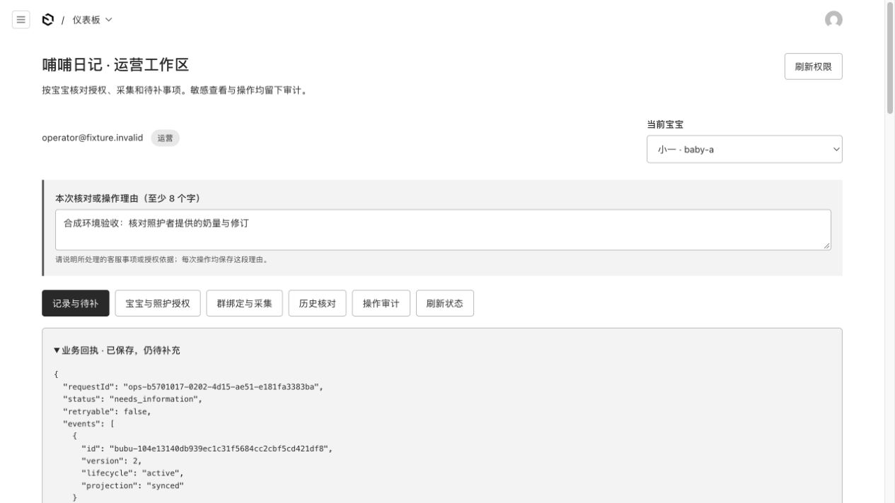
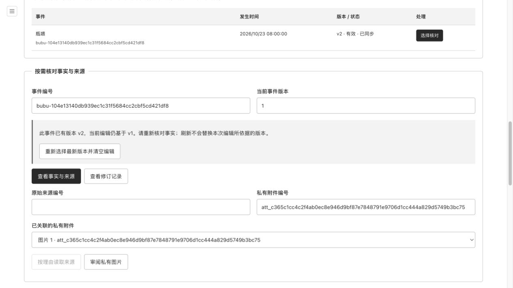
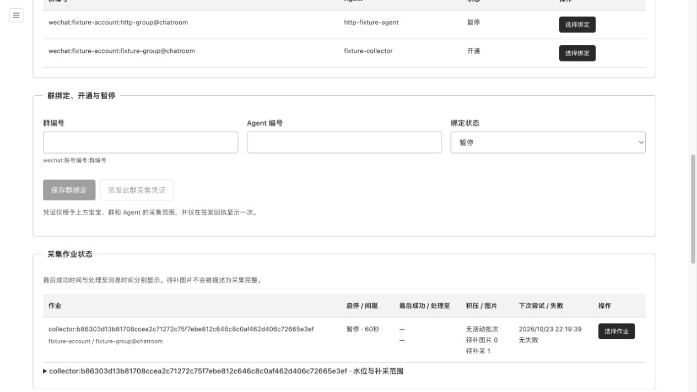
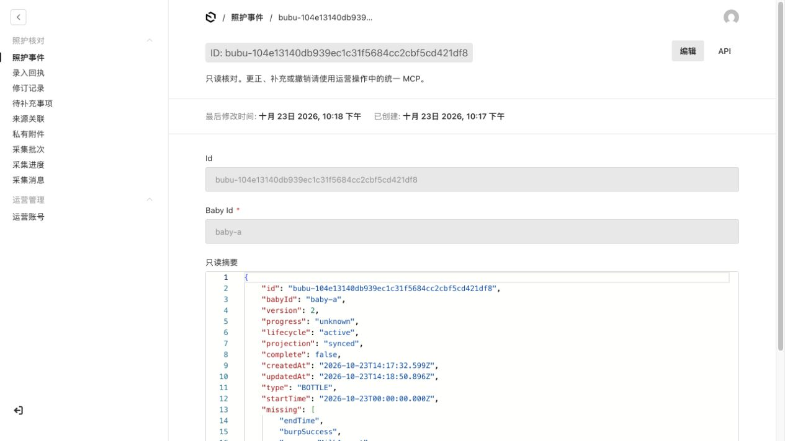
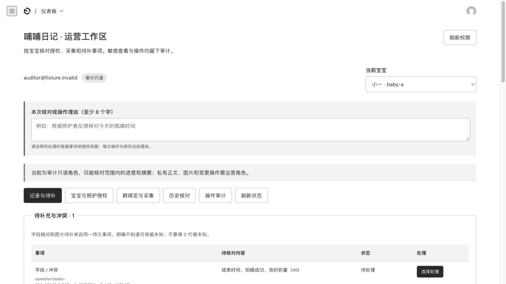

# #397 隔离运营验收记录

日期：2026-10-23。固定上游：`18e24e5d5cdc4a3d2466f35d5f47a769c63a2b95`（`codex/bubu-inapp-chat` / #402）。实现提交：`a374f19b7f216b3a966f98b07512e9abead13a6c`；后续证据提交仅补测试与本文。所有账号、宝宝、记录、照片和群 ID 都是本地合成 fixture。

## 自动化结果

- 服务端最终完整回归：311/311，23 文件，含临时委托撤销后原请求投影恢复；运营专项 18/18。
- 客户端原回归：99/99，10 文件，客户端代码未改。
- 服务端 TypeScript、ESLint、Next 生产构建通过；页面由生产构建和真实 Payload 路由提供。
- 原生 HTTP：29 项通过，包含三角色登录与 HttpOnly Cookie、禁止返回 token／session／hash、跨宝宝拒绝、隐藏集合拒读、原生照护 PATCH 拒绝、GraphQL 关闭、缺失／外源 Origin 拒绝、照护 Bearer 拒绝、同号异参拒绝、只读角色写入拒绝、私有照片范围、CLI 第二写进程阻断。
- 生产迁移：空库、仅身份、身份＋录入、身份＋录入＋聊天四条路径升级；原集合 JSON（含内部会话字段）、已知零／null、时间戳逐行保留；事务回滚、最后管理员约束、关闭重开通过。全部为隔离 SQLite。
- Knip 仍为非零：9 个既有导出、16 个既有类型及 26 条配置提示；未扩大上游 10＋16 基线，不将它报告为通过。

## 浏览器实测

真实原生 `/admin/login` 登录后，运营账号仅看到 baby-a。选择持久待补事项，填写核对理由，经页面提交实际喝入 80ml：MCP 回执 `needs_information`、事件版本升至 2、奶量从待补字段移除。其余未知继续保留。

刷新保留编辑依据版本 1，并提示当前事实已到版本 2；只有明确重新选择最新版本才清空编辑，没有把旧输入自动套到新版本。

从已有合成群作业依次执行开通、提前重试、一小时范围补采、暂停。页面显示暂停、60 秒间隔、待补采 1；未运行任何真实或合成定时执行器。另成功按理由预览当前宝宝合成私有图片。

原生照护集合详情没有创建、保存或删除入口；只读摘要不含完整 facts、原消息、会话或存储路径。原生 REST 的写入拒绝由 HTTP 测试单独确认。

审计只读角色可见相同宝宝的运行摘要，事实／来源／修订／照片读取和业务提交均禁用。直接请求的拒绝由 HTTP 与权限测试验证，不只依靠按钮。

## Review

### Standards

固定 base 到实现提交的标准轴只读审查：0 项未解决发现。仓库规范、领域文档及 ADR 一致。审查中修复了 Secure Cookie、审计排序、启动失败清理和 Origin 规范化。

### Spec

需求轴单独核对 #397 与 #391：0 项未解决发现；未发现有证据的需求遗漏、错误实现或范围扩张。开发中已修复运营照片待补角色限制、旧 Activity 读模型遗漏和编辑版本静默更新。

## 未完成的外部验收

没有读取真实客户库／私人聊天、采集真实微信群、运行真实模型、执行真实历史迁移、启用支付或部署。配置开通不会代替外部采集 runner 的部署。会员模块未实现，只有受控注入接缝。旧公开照片、跨旧库并发写入窗口、生产 HTTPS 代理及真实微信域名／凭证仍需独立验收。此结果不等于生产迁移完成。
