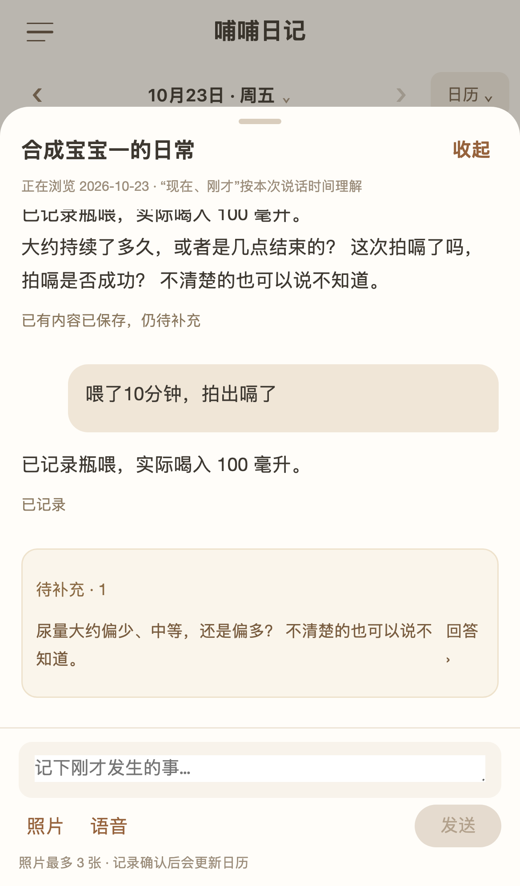
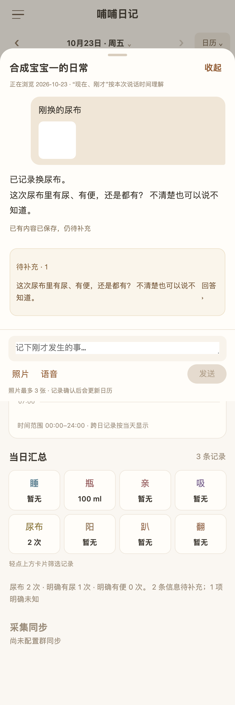
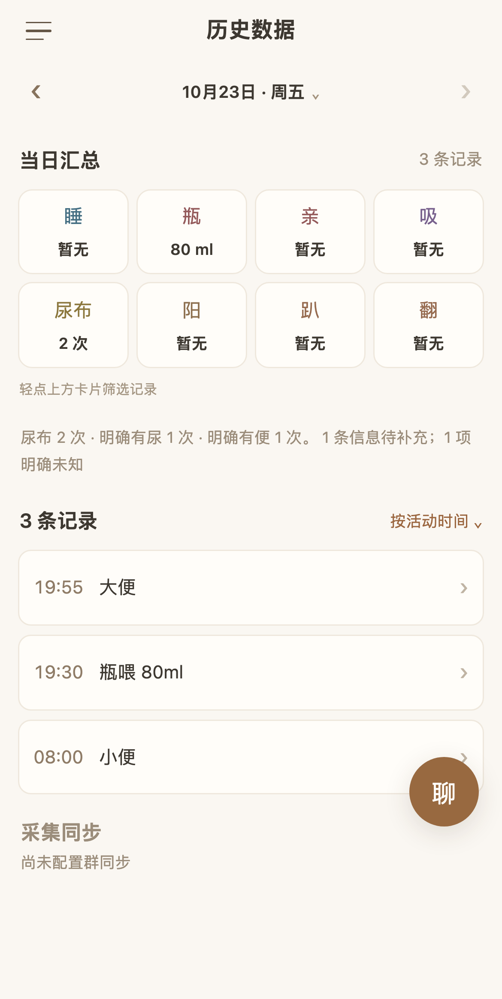
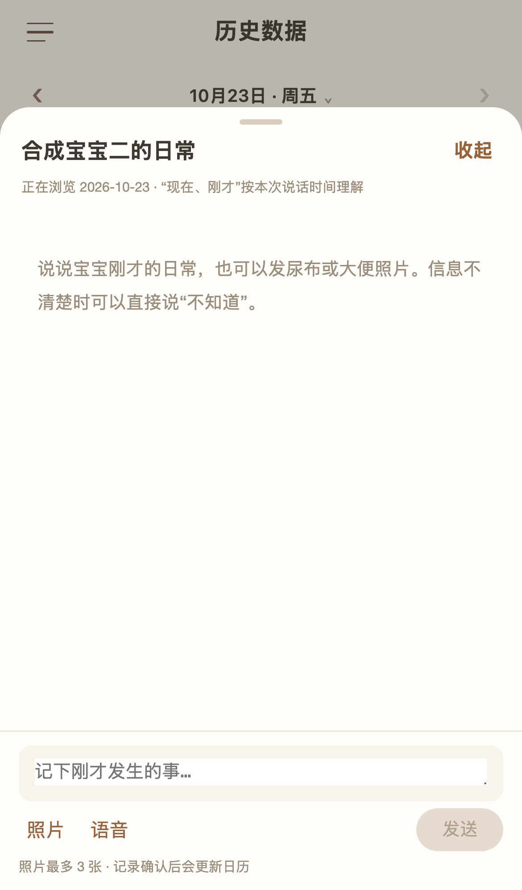

# 程序内对话隔离验收（#395）

2026-10-23，基于录入层 `75925f8a60994e46901080a23998e92f571e163d`（PR #401）。接口与配置见[聊天接入说明](../../../apps/bubu-log-service/docs/chat.md)。

| 检查 | 结果 |
| --- | --- |
| 服务端完整测试 | 280 项通过，其中 20 项聊天集成场景覆盖全部 15 类活动 |
| 客户端完整单元测试 | 99 项通过 |
| H5 sidecar 交互 | 10 项通过 |
| H5 legacy 兼容 | 5 项通过 |
| H5 实际服务闭环 | 1 个完整连续场景通过，无浏览器 API 拦截 |
| 两端类型检查、ESLint、构建 | 通过 |
| 微信原生 WXSS 编译 | 5 个样式文件通过 |
| 生产模式迁移 | 临时 SQLite 空库、身份层升级、录入层升级、事务回滚和重开通过 |
| 全仓 Knip | 未通过：上游已有 10 个导出、16 个导出类型被报告未使用；本次新增文件没有剩余告警 |

实际服务闭环使用生产 HTTP 包装、真实 Payload SQLite 与 SDK MCP；旧业务端、账号、群待补和模型输出是显式合成 fixture。场景依次验证：群尿量待补、收起保留草稿、喂奶类型追问、同瓶 120−20=100 ml、时长与拍嗝补齐、重开历史、明确未知、上传图片与保留视觉待确认、文字确认、详情进入修改为 80 ml、刷新统一统计、切换宝宝隔离。

服务集成另覆盖：母乳与奶粉分支、进行中/零/未知/不适用、跨日时间锚、图片替换和移除、跨轮图片与选中记录重新鉴权读取、图片字节不落入 transcript、只读历史、迟到答案、并发照护、重复与重叠、撤销恢复、已提交但响应丢失、服务重启、最终回复失败后恢复、注销后的迟到模型输出和原请求幂等。

真实浏览器联调发现并修复了两处契约问题：嵌套 `states.poopPhotoUrl` 枚举被误替换成图片路径，以及上传返回 `{data: attachment}` 的客户端解包。恢复复查补充了本机发送状态丢失时从服务端找回原请求。

复现：先按两个应用 README 安装依赖，在小程序目录执行 `pnpm build:h5 && pnpm test:e2e:chat-live`。默认模式为 sidecar；旧兼容测试须先用 `BUBU_AUTH_MODE=legacy` 构建并以相同模式运行 `test:e2e`。

未调用真实模型，未使用客户数据库或真实微信群，未迁移生产数据。图片 fixture 是合成小图片，不能证明真实视觉识别质量；WechatSI 仍需本产品 AppID 授权与真机麦克风验收。沿用上游单进程 SQLite 与旧站并发写入限制。Issue #395 保持打开等待环境验收。

## 浏览器截图

喂奶追问及 100 ml 确认：

图片带“刚换的尿布”说明，尿便状态仍待确认；白色缩略图为合成图片：

详情对话修改后，列表和统计同步显示 80 ml：

切换宝宝后没有上一个宝宝的私人聊天和草稿：

